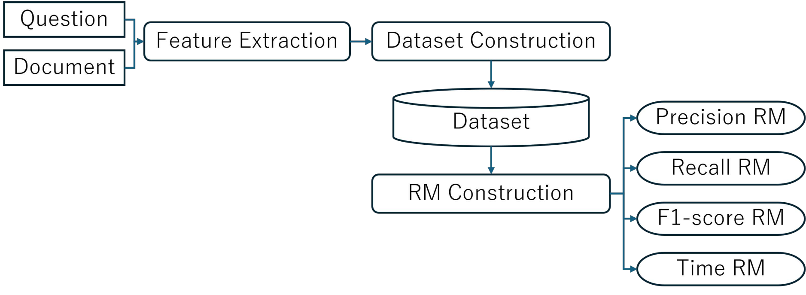
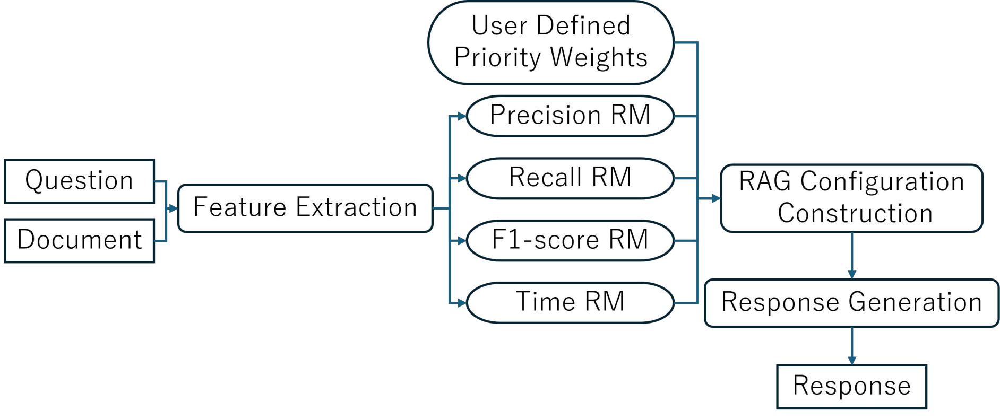

# コストと精度を考慮した質問と文書の特徴に基づく適応的なRAG構成選択

## 概要

質問と文書から特徴量を抽出し，ランキングモデルで候補となる RAG 構成を順位付けしたうえで，評価指標の重みに基づいて適合的なRAG 構成を選択するためのコードです．
`pipeline` に「複数モジュールをまとめて実行するスクリプト」を集約します．

## 概要図

<div align="center">
  
  <p>図1: ランキングモデルの学習</p>
</div>

<div align="center">
  
  <p>図2: ランキングモデルによる推論</p>
</div>

## 実行手順

### 1. 準備

NaiveRAG，LightRAG，GraphRAGで各RAG構成で実行します．
各手法の本体コードや詳細，およびデータセットについては，それぞれの公式GitHubリポジトリを参照してください．
使用したコードは`make_data/`に，実行結果は`data/raw/`に格納します．

### 2. 環境構築

Python 3.10.12で実装．
以下のコマンドで必要なライブラリをインストールします．

```bash
pip install -r requirements.txt
python -m spacy download en_core_web_sm
```

### 3. ランキングモデルの学習

`train/pipeline/make_model.py`が以下をまとめて実行します．

- `train/make_train_data.py`: 特徴量抽出と訓練データ構築
- `train/make_test_data.py`: 特徴量抽出とテストデータ構築
- `train/make_ranking_model.py`: 特徴量抽出からランキングモデル構築

```bash
python train/pipeline/make_model.py
```

### 4. ランキングモデルによる推論

`inference/pipeline/use_model.py`が以下を実行します．

- `inference/use_ranking_model.py`: ランキングモデルを評価
- `inference/selection_rag.py`: ランキング結果と重みに基づくRAG構成の選択

```bash
python inference/pipeline/make_model.py
```

## 単発実験

新たな質問と文書に対して，適応的にRAG構成を選択します．
`src/pipeline/pilot_study.py`が以下を実行します．

- `src/one_feature_extraction.py`: 特徴量抽出
- `src/one_selection_rag.py`: RAG構成選択

```bash
python src/pipeline/pilot_study.py
```

## ディレクトリ説明

### `data/`ディレクトリ

- `data/raw`：各RAGで構築したQAデータ
- `data/interim`: データセット構築で作成される中間データ
- `data/train`: ランキングモデルの訓練データ
- `data/test`: ランキングモデルのテストデータ

### `artifacts/`ディレクトリ

- `artifacts/models`: 学習済みランキングモデル
- `artifacts/registry`: 学習済みランキングモデルのメタデータ
- `artifacts/results`: 評価結果
